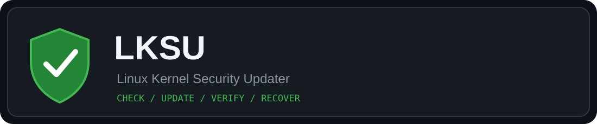
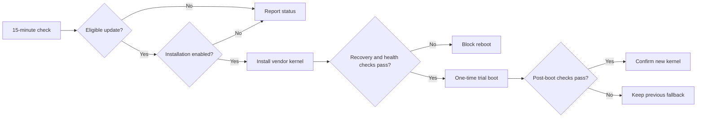

<div align="center">

# 🛡️ LKSU
### Linux Kernel Security Updater

**Safer kernel updates. Automatic checks. Verified recovery.**

[🇬🇧 English](README.md) · [🇹🇷 Türkçe](README.tr.md) · [Platform support](docs/platform-support.md)




[](https://github.com/KeygenLTD/linux-kernel-security-updater/issues)

</div>


## 🧭 Quick navigation

[Get started](#getting-started) · [Platforms](#supported-systems) · [FAQ](#frequently-asked-questions) · [Architecture](docs/architecture.md) · [Recovery](docs/recovery.md) · [CVE reporting](docs/cve-security.md)

> [!TIP]
> Detailed technical guides live in separate documents to keep this page easy to scan.

## What does LKSU do?

| 🔍 Monitor | 🛠️ Update | 🧪 Verify | ↩️ Recover |
| :---: | :---: | :---: | :---: |
| Checks every **15 minutes**, 24/7 | Installs eligible vendor kernel packages when enabled | Checks kernel and configured services after a guarded trial boot | Preserves a previous kernel and supports fallback |

**Also included:** event-based email reports (English/Turkish), custom server display names, Security Watch, conservative old-kernel cleanup, and opt-in LKSU release checks.

> **Development status:** The repository currently declares `0.3.23.dev0`. Features and tests are not proof of universal production readiness. Take an external snapshot and verify provider console access before allowing unattended reboot.

## Supported systems

| Platform | Kernel updates / guarded reboot |
| --- | --- |
| **AlmaLinux 8, 9, 10** | Implemented; verify your exact environment before production use |
| Rocky Linux, RHEL, CloudLinux | Detection / read-only inventory; automatic kernel changes blocked |
| Ubuntu, Debian | Detection / read-only inventory; automatic kernel changes blocked |
| Other detected Linux families | Detection only where implemented |

See [the platform and safety matrix](docs/platform-support.md). **Detected ≠ supported for updates.**

## Getting started

For a **test VM**, review the [installation script](install.sh), then run from a checked-out repository:

```bash
sudo ./install.sh
sudo lksu configure
lksu active
```

Configuration can authorize **real kernel installation and reboot**. Do not run the setup on an important server without a snapshot, console access, and working service health checks.

The [release bootstrap](bootstrap.sh) currently pins **v0.3.22**, not the development version. Do not treat the development branch as a published stable release.

## Useful commands

```bash
lksu active                   # Current status
lksu check --json             # Read-only kernel assessment
lksu compatibility --json     # Distribution capabilities
lksu kernel-inventory --json  # Read-only package inventory
lksu configure-automation     # Installation/reboot preferences
lksu configure-server-name    # Email/report display name
```

## Safety first

- Kernel updates use the distribution's enabled vendor repositories; no arbitrary kernel RPM downloads.
- The installer preserves existing system Python environments; do not replace CyberPanel's Python.
- Trial boot and post-boot checks reduce risk but **cannot guarantee recovery** from every failed boot.
- `/boot` space checks use a **150 MiB base reserve plus estimated kernel/initramfs requirements**; this is not a guarantee for every layout.
- LKSU self-update uses digest-checked release wheels and managed version directories. **Unmanaged/development installations are blocked from automatic self-update** pending explicit migration.
- **Zero-Day Shield is planned, not implemented.** LKSU does not currently apply CVE mitigations automatically.

## Documentation

[Platform support](docs/platform-support.md) · [Türkçe platform desteği](docs/platform-support.tr.md) · [Previous detailed README (archive)](docs/README-legacy.md) · [Source code](src/lksu/) · [Issues](https://github.com/KeygenLTD/linux-kernel-security-updater/issues)

**Security note:** A CVE is only remediated when the vendor's applicable fix is installed, the fixed kernel is running, and verification succeeds. Temporary mitigations are not equivalent to a patch.

## Frequently asked questions

<details>
<summary>Does LKSU reboot every 15 minutes?</summary>

No. Checks run every 15 minutes; automatic installation and reboot require explicit opt-ins and safety checks.

</details>

<details>
<summary>Can I recover from a failed kernel boot?</summary>

LKSU preserves the previous kernel as a fallback during a guarded trial boot. This is not a recovery guarantee: maintain an external snapshot and provider console access.

</details>

<details>
<summary>Does LKSU support automatic kernel updates on Debian, Ubuntu, Rocky or CloudLinux?</summary>

Not currently. Automatic kernel changes are restricted to validated AlmaLinux versions. See the [support matrix](docs/platform-support.md).

</details>

<details>
<summary>Does LKSU stop zero-day exploits?</summary>

No. Security Watch reports signals, and Zero-Day Shield is not implemented. A CVE fix requires the vendor patch to be installed, booted and verified.

</details>

<details>
<summary>How do I change language or server name?</summary>

Use `sudo lksu configure-language` and `sudo lksu configure-server-name`.

</details>

## Update lifecycle



## 🧩 Community and contributing

[Report an issue](https://github.com/KeygenLTD/linux-kernel-security-updater/issues/new/choose) · [Contributing guide](CONTRIBUTING.md) · [Security policy](SECURITY.md) · [Recovery playbook](docs/recovery.md) · [CVE guide](docs/cve-security.md)

> [!NOTE]
> Planned features are not implemented features. See the [issue tracker](https://github.com/KeygenLTD/linux-kernel-security-updater/issues) for current work.

## 🧰 Troubleshooting

<details>
<summary>Why are updates not installing?</summary>

Check `lksu active`, `lksu check --json` and `lksu compatibility --json`. Confirm update opt-in and distribution support.

</details>

<details>
<summary>Why was the kernel installed without a reboot?</summary>

Review `sudo lksu configure-automation`. Reboot can be blocked by missing snapshot/console confirmation, health checks or verification service readiness.

</details>
