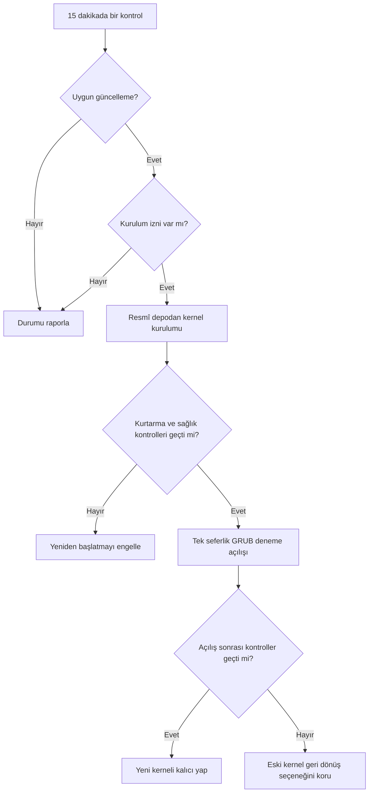

<div align="center">

# 🛡️ LKSU
### Linux Kernel Güvenlik Güncelleyicisi

**Otomatik kontrol. Güvenli kernel güncellemesi. Doğrulanabilir geri dönüş.**

[🇹🇷 Türkçe](README.tr.md) · [🇬🇧 English](README.md) · [İşletim sistemi desteği](docs/platform-support.tr.md)


[](https://github.com/KeygenLTD/linux-kernel-security-updater/issues)

</div>


## 🧭 İçindekiler

[Kurulum](#kurulum) · [Destek](#hangi-sistemlerde-çalışır) · [SSS](#-sık-sorulan-sorular) · [Mimari](docs/architecture.md) · [Kurtarma](docs/recovery.md) · [CVE](docs/cve-security.md)

> [!TIP]
> Ayrıntılı teknik belgeler ayrı sayfalarda tutulur; burası hızlı başlangıç rehberidir.

## LKSU ne yapar?

| 🔍 Kontrol | 🛠️ Güncelleme | 🧪 Doğrulama | ↩️ Geri dönüş |
| :---: | :---: | :---: | :---: |
| **7/24, 15 dakikada bir** kontrol | İzin verildiğinde resmî depolardaki uygun kernel paketlerini kurar | Deneme açılışından sonra kernel ve servisleri denetler | Önceki kerneli korur, geri dönüşe yardımcı olur |

**Diğer özellikler:** Türkçe/İngilizce olay e-postaları, sunucuya özel görünen ad, Security Watch, kontrollü eski kernel temizliği ve isteğe bağlı LKSU sürüm kontrolü.

> **Geliştirme durumu:** Depodaki sürüm `0.3.23.dev0`. Testlerin geçmesi bütün üretim ortamlarında güvenli çalışacağı anlamına gelmez. Otomatik yeniden başlatmadan önce harici snapshot ve sağlayıcı konsol erişimini doğrulayın.

## Hangi sistemlerde çalışır?

| İşletim sistemi | Kernel güncellemesi / kontrollü yeniden başlatma |
| --- | --- |
| **AlmaLinux 8, 9, 10** | Uygulandı; canlı kullanımdan önce kendi ortamınızda doğrulayın |
| Rocky Linux, RHEL, CloudLinux | Algılama ve salt okunur envanter; otomatik kernel değişikliği engelli |
| Ubuntu, Debian | Algılama ve salt okunur envanter; otomatik kernel değişikliği engelli |
| Diğer algılanabilen Linux sistemleri | Desteklenen yerlerde yalnızca algılama |

Ayrıntılar: [Platform ve güvenlik matrisi](docs/platform-support.tr.md). **Algılanması, güncellemenin desteklendiği anlamına gelmez.**

## Kurulum

Önce **test sunucusunda** deneyin. [Kurulum betiğini](install.sh) inceleyip depoyu indirdikten sonra:

```bash
sudo ./install.sh
sudo lksu configure
lksu active
```

Kurulum seçenekleri **gerçek kernel kurulumu ve yeniden başlatma** yetkisi verebilir. Kritik sunucuda önce snapshot, kurtarma konsolu ve servis sağlık kontrollerini hazırlayın.

[Bootstrap betiği](bootstrap.sh) hâlen **v0.3.22** sürümüne sabitlenmiştir; geliştirme sürümünü kurmaz.

## Sık kullanılan komutlar

```bash
lksu active                   # Genel durum
lksu check --json             # Salt okunur kernel kontrolü
lksu compatibility --json     # İşletim sistemi yetenekleri
lksu kernel-inventory --json  # Salt okunur paket envanteri
lksu configure-automation     # Otomatik kurulum/yeniden başlatma
lksu configure-server-name    # Raporlarda görünen sunucu adı
```

## Güvenlik ilkeleri

- Kernel paketleri dağıtımın etkin resmî depolarından alınır.
- CyberPanel veya sistem Python ortamı değiştirilmemelidir; LKSU ayrı Python ortamı kullanmalıdır.
- Deneme açılışı ve sağlık kontrolleri riski azaltır, **her açılış hatasından kurtulmayı garanti etmez**.
- `/boot` hesabı **150 MiB taban rezerv + tahmini kernel/initramfs ihtiyacını** kullanır; her özel disk düzeni için kesin garanti değildir.
- LKSU'nun kendi güncellemeleri doğrulanmış sürüm dosyaları ve yönetilen sürüm dizinlerini kullanır. **Geliştirme/eski kurulumlarda otomatik self-update geçiş yapılana kadar engellenir.**
- **Zero-Day Shield plan aşamasındadır; henüz CVE için otomatik geçici koruma uygulamaz.**

## Belgeler

[Platform desteği](docs/platform-support.tr.md) · [Önceki ayrıntılı README (arşiv)](docs/README-legacy.md) · [Kaynak kod](src/lksu/) · [Hata ve öneriler](https://github.com/KeygenLTD/linux-kernel-security-updater/issues)

**Not:** Bir CVE'nin kapatıldığını söylemek için üreticinin ilgili düzeltmesinin kurulması, düzeltilmiş kernelin çalışması ve doğrulama gerekir. Geçici önlem, yamanın yerini tutmaz.

## ❓ Sık sorulan sorular

<details>
<summary>LKSU her 15 dakikada bir sunucuyu yeniden başlatır mı?</summary>

Hayır. Her 15 dakikada bir kontrol yapılır; otomatik kurulum ve yeniden başlatma ayrı izinler ve güvenlik kontrolleri gerektirir.

</details>

<details>
<summary>Kernel açılmazsa eski sürüme dönebilir miyim?</summary>

LKSU, kontrollü deneme açılışında önceki kerneli geri dönüş seçeneği olarak korur. Bu kurtarma garantisi değildir; harici snapshot ve sağlayıcı konsolu erişimini hazır tutun.

</details>

<details>
<summary>Ubuntu, Debian, Rocky veya CloudLinux kernellerini otomatik günceller mi?</summary>

Şu anda hayır. Otomatik kernel değişikliği doğrulanmış AlmaLinux sürümleriyle sınırlıdır. [Destek matrisini](docs/platform-support.tr.md) inceleyin.

</details>

<details>
<summary>Zero-day açıkları otomatik engelleniyor mu?</summary>

Hayır. Security Watch raporlama amaçlıdır. Zero-Day Shield henüz uygulanmadı. Bir CVE için düzeltme, uygun üretici yamasının kurulup çalışan kernelde doğrulanmasını gerektirir.

</details>

<details>
<summary>E-posta dili ve görünen sunucu adı değiştirilebilir mi?</summary>

Evet. `sudo lksu configure-language` ve `sudo lksu configure-server-name` komutlarını kullanın.

</details>

## 🔄 Güncelleme akışı



## 🧩 Topluluk ve katkı

[Hata bildir](https://github.com/KeygenLTD/linux-kernel-security-updater/issues/new/choose) · [Katkı rehberi](CONTRIBUTING.md) · [Güvenlik politikası](SECURITY.md) · [Kurtarma rehberi](docs/recovery.md) · [CVE rehberi](docs/cve-security.md)

> [!NOTE]
> Yol haritasındaki özellikler tamamlanmış özellikler olarak sunulmaz. Güncel durum için [issue listesine](https://github.com/KeygenLTD/linux-kernel-security-updater/issues) bakın.

## 🧰 Sorun giderme

<details>
<summary>Güncelleme neden başlamıyor?</summary>

`lksu active`, `lksu check --json` ve `lksu compatibility --json` çıktılarını inceleyin. Otomatik kurulum iznini ve dağıtım desteğini kontrol edin.

</details>

<details>
<summary>Kernel kuruldu ancak sunucu yeniden başlamadı; neden?</summary>

`sudo lksu configure-automation` ile izinleri inceleyin. Snapshot/konsol onayı, sağlık kontrolleri veya doğrulama servisi şartları sağlanmadıysa yeniden başlatma güvenlik nedeniyle engellenebilir.

</details>
