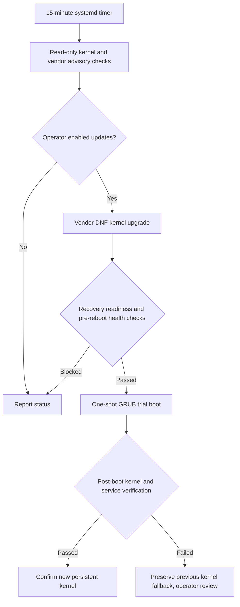

# LKSU architecture

## Boundaries

- Automatic kernel installation is restricted to supported AlmaLinux backends. See [platform support](platform-support.md).
- The installer uses an isolated Python environment and must not replace CyberPanel or system Python.
- GRUB trial boot is not a guarantee of recovery from disk, bootloader or provider failures.
- Security Watch observes and reports host signals; it does not automatically remediate CVEs.
- No automatic zero-day mitigation engine is implemented.

See [recovery](recovery.md) and [CVE reporting](cve-security.md).
